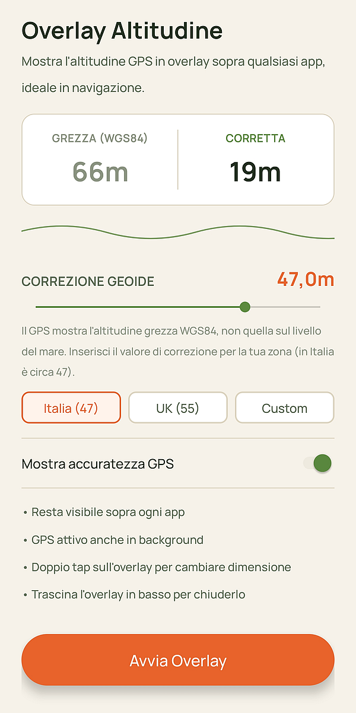
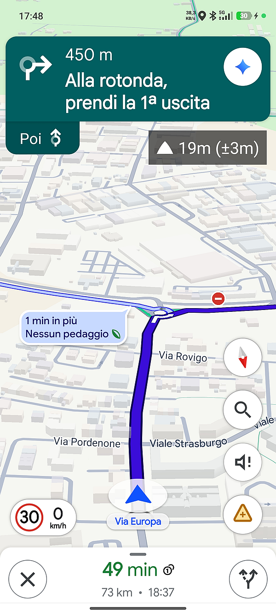
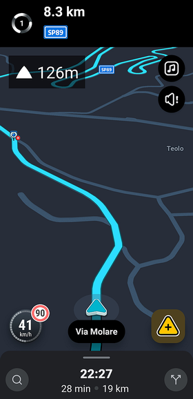

# Fastigum
### Altitude Overlay for Android (GPS Altitude Overlay)


App Android che mostra un overlay flottante con l'altitudine GPS in tempo reale, utilizzabile sopra qualsiasi altra app — perfetto con il tuo programma di navigazione preferito.

<p align="center">
  
  
  
</p>

## ⬇️ Download

Fastigum è distribuita come app a pagamento su Google Play (in arrivo). Su GitHub trovi il codice sorgente di ogni versione nella pagina delle [Release](../../releases/latest) e l'apk delle versioni precedenti.

## ✨ Funzionalità

- **Overlay sempre visibile**, anche sopra Google Maps e altre app
- **Trascinabile** — sposta l'overlay dove preferisci con il dito
- **Ridimensionabile** — doppio tap per ciclare tra 3 dimensioni (piccola/media/grande)
- **Correzione geoidale configurabile** — mostra l'altitudine reale sul livello del mare, non quella grezza ellissoidica WGS84 restituita dal GPS (impostabile per qualsiasi zona del mondo)
- **Basso consumo energetico** tramite `FusedLocationProviderClient`
- Aggiornamento della posizione ogni secondo

## 📱 Come si usa

1. Apri l'app e inserisci il valore di correzione geoide per la tua zona (in Italia settentrionale è circa **47**)
2. Tocca **"Avvia Overlay"**
3. Concedi i permessi richiesti (localizzazione + overlay su altre app)
4. Apri Google Maps o qualsiasi altra app — l'overlay resta visibile
5. **Trascina** l'overlay per riposizionarlo, **doppio tap** per cambiarne la dimensione

## 🛠️ Build da sorgente

Prerequisiti: JDK 17, Android SDK (API 36, build-tools 35.0.0), Android Gradle Plugin 8.13.2 e Kotlin 2.1.21. Gradle 8.13 è gestito automaticamente dal wrapper incluso.

```bash
git clone https://github.com/trevi020/gps-altitude-overlay.git
cd gps-altitude-overlay
./gradlew assembleRelease --no-daemon
```

Guida dettagliata (Codespaces, Android Studio, firma, bundle per Google Play): [docs/SETUP_GUIDE.md](docs/SETUP_GUIDE.md)
